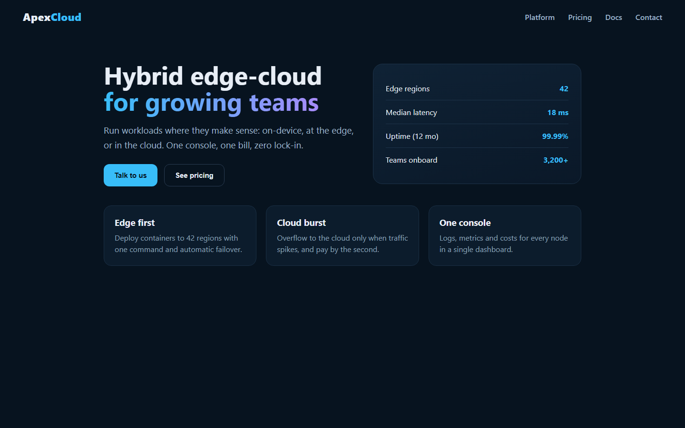
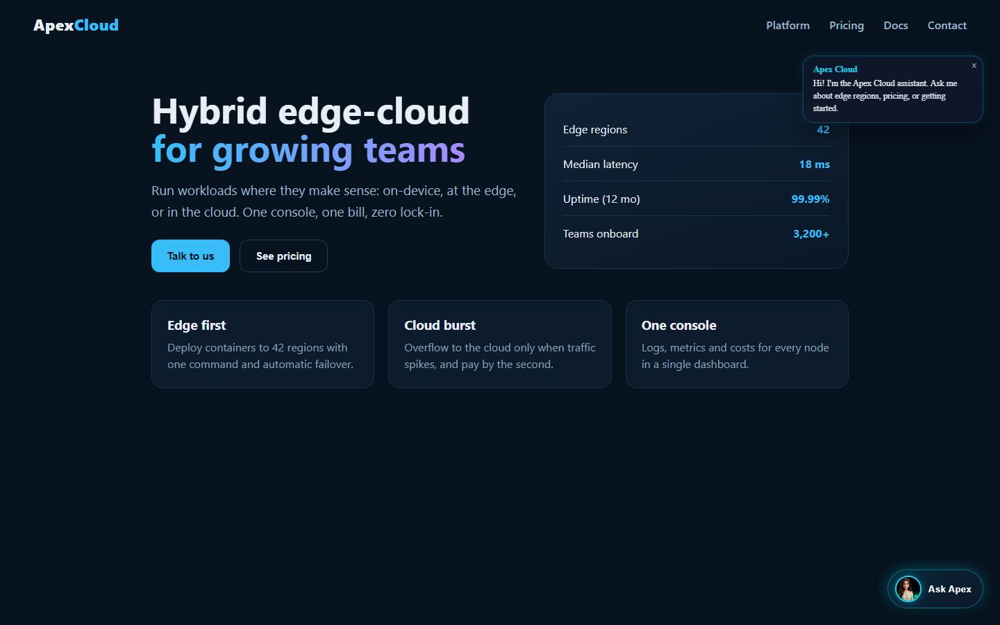
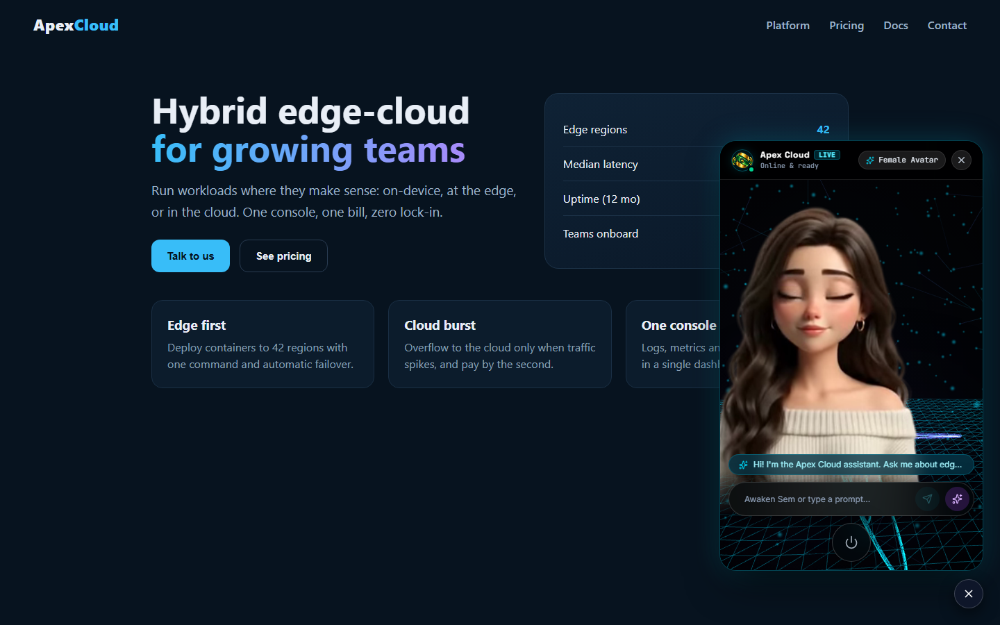

# Sem Live Assistant: a Semdok Harness plugin

Add **Sem**, Semdok's 3D conversational assistant from [live.semdok.com](https://live.semdok.com), to any website,
just by asking the Semdok Harness agent.

| Before | After | Sem open |
|---|---|---|
|  |  |  |

## Install

In Semdok Harness, either:

- **Plugins → Discover**, with the Semdok Plugins market
  (`https://raw.githubusercontent.com/YumnamMomojit/Plugins/main/index.json`), then **Install** on *Sem Live Assistant*; or
- **Plugins → Add plugin**, and enter `github:YumnamMomojit/Plugins#main&path:/plugins/semdok-live`.

## Use

Ask the agent, for example:

- *Add Sem to my website. Brand it "Apex Cloud", bottom left, greeting "Hi! How can I help?"*
- *Put the Semdok assistant on this Next.js site with key sem_pub_live_…*
- *How do I add Sem to my Shopify store?*

The plugin adds:

- the **`semdok_live_embed_code`** tool, which builds a validated script tag for the site type (HTML, React/Vite,
  Next.js App or Pages Router, WordPress, Shopify, Wix, Webflow) with placement steps, and
- the **`semdok-live`** skill, which tells the agent how to find the site type, avoid duplicate widgets, insert the
  tag with normal (approvable) edits, and check the result.

## Keys

The widget needs the assistant's **public key** (`sem_pub_live_…`) from **Semdok Console → Assistants**;
`sem_pub_demo` works for testing. The widget hands its key to the visitor's browser, so the tool **refuses secret
keys** (`sk-…` / `sk_…`). In the Console, limit each assistant to your own domains.

## Widget options

| Option | Values | Default |
|---|---|---|
| brand | any text | SEM Assistant |
| greeting | any text | Hi there! I'm SEM… |
| avatar | female, male | female |
| theme, background | names from the Console | cyan, cyber |
| position | bottom-right, bottom-left, top-right, top-left | bottom-right |
| button label | any text | Ask SEM |
| auto open | true, false | false |

The generated tag always sets `data-origin="https://live.semdok.com"`, so the widget also works when the site is
previewed on `localhost`. Pages can control the assistant with `window.SemAssistant.open()`, `.close()`,
`.toggle()`, `.sendMessage(text)` and `.on(event, callback)`.

## Demo

`demo/` holds the Apex Cloud page from the screenshots: `node plugins/semdok-live/demo/serve.cjs`, then open
http://127.0.0.1:18891 (`before.html` shows the page without Sem).

## License

MIT. Sem and live.semdok.com are services of Semdok.
